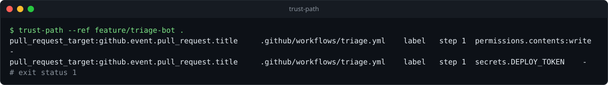
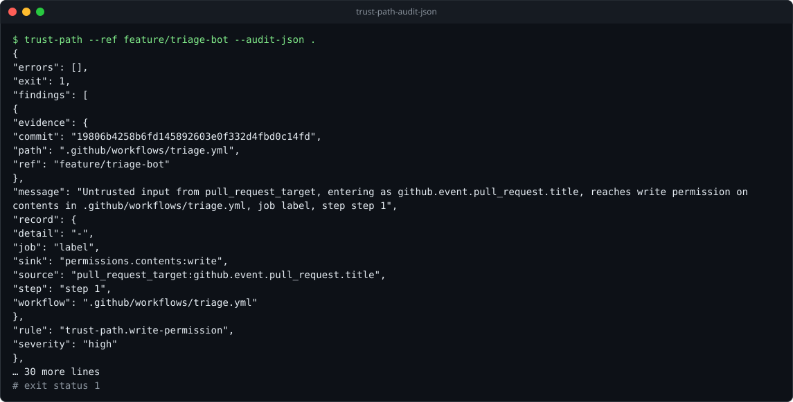

# trust-path

[](https://pypi.org/project/trust-path/) [](https://github.com/jacob-adm/trust-path/blob/main/pyproject.toml) [](https://github.com/jacob-adm/trust-path#license)

trust-path lists the paths by which untrusted input can reach a secret or a publishing credential
in a repository's GitHub Actions workflows, or Gitea and Forgejo Actions workflows with `--forge`
(see [Gitea and Forgejo](https://github.com/jacob-adm/trust-path/blob/main/docs/commands.md#gitea-and-forgejo)),
as far as the workflow files show them: repository
settings and the code of the actions a step uses are outside what it reads (see
[Limitations](https://github.com/jacob-adm/trust-path/blob/main/docs/limitations-and-security.md)). Untrusted input is text or code that anyone can supply:
a pull request title, an issue body, a comment, a fork's branch name or code. A sink is what that
input can reach: a secret, an OIDC token (`id-token: write`), a write permission of the workflow
token, a deployment environment, or an AI agent action holding a credential.

These paths are used. In May 2026 malware reached the release workflow of TanStack/router through
GitHub Actions cache poisoning, read an OIDC token from the runner's memory and published 84
malicious versions of 42 TanStack packages with it. The malware was written to republish itself
to other packages its victims maintained ([postmortem](https://tanstack.com/blog/npm-supply-chain-compromise-postmortem)).
Researchers showed that text in issue bodies, pull request descriptions and comments can make an AI
agent action leak its secrets
([Microsoft](https://www.microsoft.com/en-us/security/blog/2026/06/05/securing-ci-cd-in-agentic-world-claude-code-github-action-case))
and that instructions hidden in an issue can make agents run commands
([Cloud Security Alliance](https://labs.cloudsecurityalliance.org/research/csa-research-note-ai-github-actions-security-20260503-csa-st/)).
trust-path shows where such paths exist, including paths that cross
from one workflow to another through `workflow_run` and reusable workflows. It reports; it does not
change workflows or decide what to do about a path.

[zizmor](https://github.com/zizmorcore/zizmor) and [poutine](https://github.com/boostsecurityio/poutine)
check many more things. They report an untrusted input, a broad secret or a broad permission at the
place in a file where it appears. trust-path adds four things: it pairs each source with the
secret, permission or environment it reaches; it follows a source from one workflow to the next
through `workflow_run` chains and local reusable workflows; it follows pull request code through
the Actions cache to the release and push jobs that restore it, the path of the TanStack worm;
and it treats AI agent actions as sinks. See [Using it with other tools](https://github.com/jacob-adm/trust-path/blob/main/docs/other-tools.md).

It is one of six audit tools that print the same result format with `--audit-json`.
[suite-gate](https://github.com/jacob-adm/suite-gate) runs them together and gives one verdict per
branch, as a command, a GitHub Action or an MCP server for coding agents.

## Example output

A demo workflow that runs on `pull_request_target`, puts the pull request title into a shell
step, and holds a secret and the `contents: write` permission:

<p align="center"></p>

The same branch with `--audit-json` (first lines of the result):

<p align="center"></p>

## Requirements

- Python 3.9 or later, standard library only.
- Written for Linux, macOS and Windows. The tests have been run on macOS with Python 3.9 and
  3.14; `.github/workflows/test.yml` runs them on all three systems with Python 3.9 and 3.13
  where GitHub Actions is enabled.

## Install

From PyPI:

```
pip install trust-path
```

From a clone:

```
git clone https://github.com/jacob-adm/trust-path
cd trust-path
pip install .
```

Either way pip installs `trust-path` as a console script. Without installing, it runs from a clone as
`python3 -m trust_path`.

## How it works

1. **Read the workflows.** trust-path reads every `.yml` and `.yaml` file in
   `DIR/.github/workflows` with its own YAML reader, which refuses any construct it does not read
   rather than guess. A refused file is named on standard error with the reason, the other files
   are still checked, and the exit status is 2.
2. **Find untrusted runs.** A workflow runs with untrusted input when it has a trigger such as
   `pull_request_target`, `issues` or `issue_comment`, when it runs on `workflow_run` after such a
   workflow or after a `pull_request` workflow (followed through chains), or when it is a local
   reusable workflow called from such a run.
3. **Find where input enters each job.** A step enters untrusted input when it uses a context such
   as `github.event.pull_request.title` in `run:` or `with:` (directly, or through
   `${{ env.NAME }}`, or by passing such a variable to `eval` or `sh -c` or writing it to
   `GITHUB_ENV`), checks out or fetches the pull request's head, downloads an artifact from the upstream run, expands the changed file names of a pull
   request, or is an AI agent action.
4. **Collect what it reaches.** The entry step and every later step of the same job are reached.
   trust-path collects the secrets they use and the job's write permissions, `id-token: write`,
   environment and AI agent actions holding a credential.
5. **Print one record per path.** Each record is `source`, `workflow`, `job`, `step`, `sink` and `detail`,
   tab-separated and sorted. Like `grep`, trust-path exits 1 when it finds a path, 0 when it finds
   none and 2 on an error, including any refused file.

## Commands

```
trust-path [--json | --audit-json] DIR
trust-path [--json | --audit-json] --ref REF [DIR]
```

`--json` writes the records as a JSON array. `--ref REF` reads the workflows from git at a branch,
tag or commit without checking it out; it is the only option that runs git. See [Command](https://github.com/jacob-adm/trust-path/blob/main/docs/commands.md) for the fields and
exit status.

## Quick start

From a clone, run it on the test fixture with an AI agent action:

```sh
trust-path tests/fixtures/agent
```

```text
issues:event text read by agent	.github/workflows/triage.yml	triage	anthropics/claude-code-action@v1	agent:anthropics/claude-code-action	gate=anyone; tools=action-default
issues:event text read by agent	.github/workflows/triage.yml	triage	anthropics/claude-code-action@v1	permissions.issues:write	gate=anyone; tools=action-default
issues:event text read by agent	.github/workflows/triage.yml	triage	anthropics/claude-code-action@v1	secrets.ANTHROPIC_API_KEY	gate=anyone; tools=action-default
issues:event text read by agent	.github/workflows/triage.yml	triage	anthropics/claude-code-action@v1	secrets.GITHUB_TOKEN	gate=anyone; tools=action-default
issues:github.event.issue.body	.github/workflows/triage.yml	triage	anthropics/claude-code-action@v1	agent:anthropics/claude-code-action	gate=anyone; tools=action-default
issues:github.event.issue.body	.github/workflows/triage.yml	triage	anthropics/claude-code-action@v1	permissions.issues:write	-
issues:github.event.issue.body	.github/workflows/triage.yml	triage	anthropics/claude-code-action@v1	secrets.ANTHROPIC_API_KEY	-
issues:github.event.issue.body	.github/workflows/triage.yml	triage	anthropics/claude-code-action@v1	secrets.GITHUB_TOKEN	-
```

The workflow runs when an issue is opened and gives `anthropics/claude-code-action` the issue body
in its prompt, an API key and a token that can write issues. The last field shows how the workflow
sets the agent up: `gate=anyone` because `allowed_non_write_users` is `*`, so the agent runs for
users without write access, and `tools=action-default` because the workflow does not limit its
tools. Anyone who can open an issue writes that text, and the agent acts on it while holding the
key and can write text into issues that other workflows and agents read. Run `trust-path .` in a repository checkout to check its workflows.

## Documentation

- [For coding agents](https://github.com/jacob-adm/trust-path/blob/main/docs/AGENTS.md): how an agent runs trust-path, reads `--audit-json` and cites the evidence.
- [How trust-path finds paths](https://github.com/jacob-adm/trust-path/blob/main/docs/model.md): sources, entry points, sinks, the AI agent action
  list and the YAML subset.
- [Command](https://github.com/jacob-adm/trust-path/blob/main/docs/commands.md): output fields, JSON, exit status and an example across workflows.
- [Running it in CI](https://github.com/jacob-adm/trust-path/blob/main/docs/ci.md): a tested GitHub Actions workflow that fails when a pull request adds a path, and a pre-commit hook.
- [Limitations and security](https://github.com/jacob-adm/trust-path/blob/main/docs/limitations-and-security.md): what trust-path does not see, read or do.
- [Benchmark](https://github.com/jacob-adm/trust-path/blob/main/docs/benchmark.md): a repeatable run on pinned public workflows, with a
  per-file comparison against zizmor
- [Using it with other tools](https://github.com/jacob-adm/trust-path/blob/main/docs/other-tools.md): a tested stack with git surface
  and git-overlap, and what zizmor and poutine cover and what trust-path adds.
- [Contributing](https://github.com/jacob-adm/trust-path/blob/main/CONTRIBUTING.md): running the tests and contributing a change.
- [Reporting a vulnerability](https://github.com/jacob-adm/trust-path/blob/main/SECURITY.md)

## License

Apache License 2.0; see [LICENSE](https://github.com/jacob-adm/trust-path/blob/main/LICENSE).
